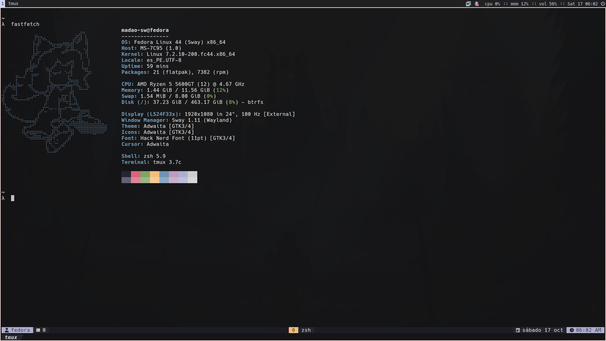
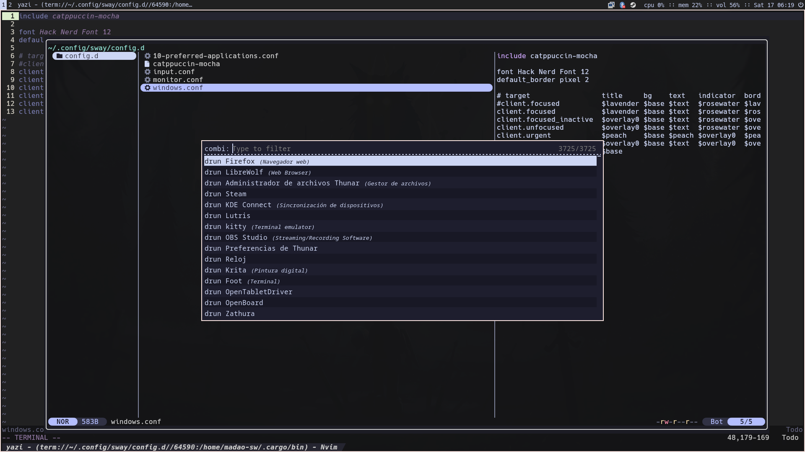

Future me of if someelse get here...

# Dotfiles

My personal dotfiles for **Fedora Sway Spin**.

This repository contains a basic configuration to get started with Sway on Fedora. It serves as a starting point for my own setup, with custom colors, window rules, and other personal tweaks.

My configuration is based on these files, with modifications following Fedora's Sway configuration guidelines. Instead of copying and replacing the default `/etc/sway/config`, I use the `config.d`.

### Tmux plugins

Managed with [TPM (Tmux Plugin Manager)](https://github.com/tmux-plugins/tpm):

- [tmux-resurrect](https://github.com/tmux-plugins/tmux-resurrect) — Restore tmux sessions.
- [tmux-continuum](https://github.com/tmux-plugins/tmux-continuum) — Automatically save and restore sessions.

## Additional customization

- **Catppuccin SDDM theme**, personal background image.

## Notes

These dotfiles reflect my personal preferences. I started by copying someone else's dotfiles and tweaking the colors until I was happy with the result. Feel free to do the same.

I'll also upload pictures of my current desktop setup, which may not exactly match the configuration in this repository.

## Screenshots

